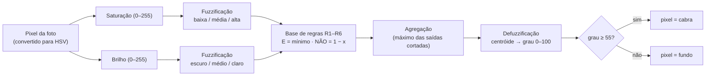

# Aplicando lógica fuzzy em problemas do cotidiano

**Disciplina:** Inteligência Artificial · **Professora:** Érica Carvalho

**Tema:** separar um objeto do fundo de uma foto (segmentação de imagem), comparando um filtro booleano com um sistema fuzzy.

## Parte 1: Pesquisa e análise

### Problema escolhido

Recortar o objeto principal de uma foto e separá-lo do fundo, como fazem o "modo retrato" do celular, a remoção de fundo em apps de foto e os filtros de videochamada. No nosso caso, o objetivo é encontrar **os pixels que pertencem à cabra branca** da imagem `img/cabra.jpg`.

Esse problema é de grau, e não de sim/não, porque a cor de um pelo branco muda conforme a luz:

- ao sol, o pelo é **muito claro e sem cor** (claramente "cabra");
- na sombra (pescoço, peito, barriga), o mesmo pelo fica **cinza-azulado e mais escuro**: continua sendo cabra, mas "parece menos" branco;
- o fundo desfocado tem manchas **bege claras** que se parecem um pouco com o pelo.

Um filtro booleano usa um corte fixo, por exemplo "brilho ≥ 110". Com isso, um pixel com brilho 109 é jogado fora por inteiro, mesmo sendo quase igual a outro com brilho 110. A lógica fuzzy trata essa transição de forma gradual.

### Variáveis linguísticas

| Variável | Tipo | Universo | O que mede |
|---|---|---|---|
| **Saturação** | entrada | 0 a 255 (canal S do HSV) | quanto o pixel é "colorido" (grama = muito; pelo branco = pouco) |
| **Brilho** | entrada | 0 a 255 (canal V do HSV) | quanto o pixel é claro ou escuro |
| **Cabra** | saída | 0 a 100 | grau de certeza de que o pixel faz parte da cabra |

### Termos fuzzy

| Variável | Termos | Função de pertinência |
|---|---|---|
| Saturação | **baixa** | trapézio (0, 0, 40, 90) |
|  | **média** | triângulo (40, 90, 150) |
|  | **alta** | trapézio (100, 170, 255, 255) |
| Brilho | **escuro** | trapézio (0, 0, 50, 110) |
|  | **médio** | triângulo (60, 130, 200) |
|  | **claro** | trapézio (150, 210, 255, 255) |
| Cabra | **não** | triângulo (0, 0, 45) |
|  | **talvez** | triângulo (25, 50, 75) |
|  | **sim** | triângulo (55, 100, 100) |

Os termos vizinhos se sobrepõem de propósito. Por exemplo, saturação 65 é ao mesmo tempo 0,5 "baixa" e 0,5 "média".

### Exemplo de regra fuzzy

> **SE** a saturação é **baixa** **E** o brilho é **médio** **ENTÃO** o pixel **é cabra** (sim).

Essa regra representa o pelo branco na sombra. É justamente o caso que o filtro booleano perde.

Base de regras completa usada na implementação:

| # | Regra | Intuição |
|---|---|---|
| R1 | SE saturação é baixa E brilho é claro → cabra é **sim** | pelo branco ao sol |
| R2 | SE saturação é baixa E brilho é médio → cabra é **sim** | pelo branco na sombra |
| R3 | SE saturação é baixa E brilho é escuro → cabra é **talvez** | sombra forte ou cinza escuro |
| R4 | SE saturação é média E brilho NÃO é escuro → cabra é **talvez** | fundo bege ou pelo com reflexo |
| R5 | SE saturação é alta → cabra é **não** | grama verde, corda |
| R6 | SE brilho é escuro E saturação NÃO é baixa → cabra é **não** | regiões escuras e coloridas |

---

## Parte 2: Aplicação conceitual

### Diagrama do sistema fuzzy



Versão em texto, caso o Mermaid não seja renderizado no PDF:

```
 pixel ─► [Saturação] ─► Fuzzificação (baixa, média, alta) ──┐
       └► [Brilho]    ─► Fuzzificação (escuro, médio, claro) ─┤
                                                              ▼
                                         Regras R1..R6 (Mamdani: E = mín)
                                                              ▼
                                         Agregação (máx) das saídas "não/talvez/sim"
                                                              ▼
                                         Defuzzificação por centróide ─► grau 0..100
                                                              ▼
                                         grau ≥ 55 → cabra · senão → fundo
```

### Como funciona cada etapa

1. **Entradas → Fuzzificação.** Cada pixel tem uma saturação e um brilho (números). A fuzzificação transforma esses números em graus de pertinência aos termos. Exemplo: o pescoço na sombra (S = 56, V = 94) fica 0,68 "saturação baixa" e 0,32 "saturação média"; no brilho, fica 0,27 "escuro" e 0,49 "médio".
2. **Regras fuzzy.** Cada regra "dispara" com a força do seu antecedente, e o operador **E** é o mínimo. No pescoço, R2 dispara com mín(0,68; 0,49) = 0,49 para "sim"; R3 dispara com mín(0,68; 0,27) = 0,27 para "talvez"; e assim por diante.
3. **Saída → Defuzzificação (qualitativa).** Cada regra "corta" a curva do seu termo de saída na altura da sua força, e as curvas cortadas são unidas (máximo) numa única forma. A **defuzzificação por centróide** pega o "centro de massa" dessa forma. Se a maior parte da área está em "sim", o número fica perto de 100; se a área está dividida entre "sim" e "talvez", ele cai no meio. O resultado é um único número que resume a opinião de todas as regras ao mesmo tempo.
4. **Decisão final.** Para desenhar a máscara, os pixels com grau ≥ 55 são considerados cabra. Depois é feita uma limpeza espacial (remoção de ruído e de regiões pequenas, e preenchimento de buracos), igual nos dois métodos.

---

## Parte 3: Implementação

| Arquivo | Conteúdo |
|---|---|
| `src/filter.py` | abordagem booleana: `cv2.inRange` com S ≤ 70 e V ≥ 110 |
| `src/fuzzy.py` | sistema fuzzy Mamdani completo (variáveis, termos, regras R1–R6, centróide) |
| `src/core.py` | partes iguais para os dois: carregar a imagem, limpar a máscara e salvar o resultado |

### Como executar

```bash
pip install -r requirements.txt
python src/filter.py   # gera img/resultado_filter.png
python src/fuzzy.py    # gera img/resultado_fuzzy.png
```
