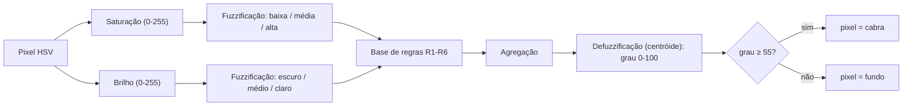

# Aplicando lógica fuzzy em problemas do cotidiano

**Disciplina:** Inteligência Artificial · **Professora:** Érica Carvalho

**Tema:** separar um objeto do fundo de uma foto (segmentação de imagem), comparando um filtro booleano com um sistema fuzzy.

## Parte 1: Pesquisa e análise

### Problema escolhido

Identificar o objeto principal em uma imagem, como fazem o "modo retrato" do celular e apps de remoção de fundo. Escolhemos fazer com a imagem de uma cabra (`img/cabra.jpg`)

Esse problema é de grau porque a cor do pelo branco muda conforme a luz:

- ao sol, o pelo é **muito claro e sem cor**
- na sombra (pescoço, peito, barriga), o mesmo pelo fica **cinza-azulado e mais escuro**

Um filtro booleano usa um corte fixo, por exemplo "brilho ≥ 110". Com isso, um pixel com brilho 109 é jogado fora por inteiro, mesmo sendo quase igual a outro com brilho 110. A lógica fuzzy trata essa transição de forma gradual.

### Variáveis linguísticas

| Variável | Tipo | Universo | O que mede |
|---|---|---|---|
| **Saturação** | entrada | 0 a 255 (canal S do HSV) | quanto o pixel é "colorido" |
| **Brilho** | entrada | 0 a 255 (canal V do HSV) | quanto o pixel é claro ou escuro |
| **Cabra** | saída | 0 a 100 | grau de certeza de que o pixel faz parte da cabra |

### Termos fuzzy

| Variável | Termos | Função de pertinência |
|---|---|---|
| Saturação | **baixa** | trapézio (0, 0, 40, 90) |
|  | **média** | triângulo (40, 90, 150) |
|  | **alta** | trapézio (100, 170, 255, 255) |
| Brilho | **escuro** | trapézio (0, 0, 50, 110) |
|  | **médio** | triângulo (60, 130, 200) |
|  | **claro** | trapézio (150, 210, 255, 255) |
| Cabra | **não** | triângulo (0, 0, 45) |
|  | **talvez** | triângulo (25, 50, 75) |
|  | **sim** | triângulo (55, 100, 100) |

### Regras fuzzy

| # | Regra | Intuição |
|---|---|---|
| R1 | SE saturação é baixa E brilho é claro → cabra é **sim** | pelo branco no sol |
| R2 | SE saturação é baixa E brilho é médio → cabra é **sim** | pelo branco na sombra |
| R3 | SE saturação é baixa E brilho é escuro → cabra é **talvez** | sombra forte ou cinza escuro |
| R4 | SE saturação é média E brilho NÃO é escuro → cabra é **talvez** | fundo bege ou pelo com reflexo |
| R5 | SE saturação é alta → cabra é **não** | grama verde, corda |
| R6 | SE brilho é escuro E saturação NÃO é baixa → cabra é **não** | regiões escuras e coloridas |

## Parte 2: Aplicação conceitual

### Diagrama do sistema fuzzy



> Esse diagrama pode ser visto no `README.pdf`

## Parte 3: Implementação

| Arquivo | Conteúdo |
|---|---|
| `src/filter.py` | abordagem booleana |
| `src/fuzzy.py` | abordagem fuzzy |
| `src/core.py` | funções compartilhadas |

### Como executar

```bash
pip install -r requirements.txt
python src/filter.py # gera img/resultado_filter.png
python src/fuzzy.py  # gera img/resultado_fuzzy.png
```
