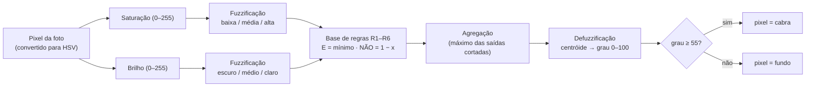

# Detecção de regiões brancas na imagem

Este projeto compara duas formas simples de destacar regiões claras e pouco saturadas na imagem `img/cabra.jpg`:

- `src/filter.py`: abordagem booleana, com limite fixo de saturação e brilho no espaço HSV (cada pixel é 0 ou 1).
- `src/fuzzy.py`: sistema fuzzy Mamdani (scikit-fuzzy) com as entradas saturação e brilho, 6 regras e defuzzificação por centróide. Gera um grau de 0 a 100 para cada pixel.
- `src/core.py`: funções usadas pelos dois scripts (carregar a imagem, limpar a máscara e salvar o resultado).

Os scripts classificam pixels pela cor; eles não reconhecem a cabra como objeto.

## Criar o ambiente e instalar dependências

Na pasta do projeto, execute:

```bash
python3 -m venv .venv
source .venv/bin/activate
python -m pip install --upgrade pip
pip install -r requirements.txt
```

No Windows (Prompt de Comando), ative o ambiente com:

```bat
.venv\Scripts\activate
```

## Executar

Com a `.venv` ativada, execute a partir da pasta do projeto:

```bash
python src/filter.py
python src/fuzzy.py
```

Os resultados serão gravados em `img/`:

- `img/resultado_filter.png`
- `img/resultado_fuzzy.png`

Para sair do ambiente virtual:

```bash
deactivate
```

---

# Aplicando lógica fuzzy em problemas do cotidiano

**Disciplina:** Inteligência Artificial · **Professora:** Érica Carvalho

**Tema:** separar um objeto do fundo de uma foto (segmentação de imagem), comparando um filtro booleano com um sistema fuzzy.

---

## Parte 1: Pesquisa e análise

### Problema escolhido

Recortar o objeto principal de uma foto e separá-lo do fundo, como fazem o "modo retrato" do celular, a remoção de fundo em apps de foto e os filtros de videochamada. No nosso caso, o objetivo é encontrar **os pixels que pertencem à cabra branca** da imagem `img/cabra.jpg`.

Esse problema é de grau, e não de sim/não, porque a cor de um pelo branco muda conforme a luz:

- ao sol, o pelo é **muito claro e sem cor** (claramente "cabra");
- na sombra (pescoço, peito, barriga), o mesmo pelo fica **cinza-azulado e mais escuro**: continua sendo cabra, mas "parece menos" branco;
- o fundo desfocado tem manchas **bege claras** que se parecem um pouco com o pelo.

Um filtro booleano usa um corte fixo, por exemplo "brilho ≥ 110". Com isso, um pixel com brilho 109 é jogado fora por inteiro, mesmo sendo quase igual a outro com brilho 110. A lógica fuzzy trata essa transição de forma gradual.

### Variáveis linguísticas

| Variável | Tipo | Universo | O que mede |
|---|---|---|---|
| **Saturação** | entrada | 0 a 255 (canal S do HSV) | quanto o pixel é "colorido" (grama = muito; pelo branco = pouco) |
| **Brilho** | entrada | 0 a 255 (canal V do HSV) | quanto o pixel é claro ou escuro |
| **Cabra** | saída | 0 a 100 | grau de certeza de que o pixel faz parte da cabra |

### Termos fuzzy

| Variável | Termos | Função de pertinência |
|---|---|---|
| Saturação | **baixa** | trapézio (0, 0, 40, 90) |
|  | **média** | triângulo (40, 90, 150) |
|  | **alta** | trapézio (100, 170, 255, 255) |
| Brilho | **escuro** | trapézio (0, 0, 50, 110) |
|  | **médio** | triângulo (60, 130, 200) |
|  | **claro** | trapézio (150, 210, 255, 255) |
| Cabra | **não** | triângulo (0, 0, 45) |
|  | **talvez** | triângulo (25, 50, 75) |
|  | **sim** | triângulo (55, 100, 100) |

Os termos vizinhos se sobrepõem de propósito. Por exemplo, saturação 65 é ao mesmo tempo 0,5 "baixa" e 0,5 "média".

### Exemplo de regra fuzzy

> **SE** a saturação é **baixa** **E** o brilho é **médio** **ENTÃO** o pixel **é cabra** (sim).

Essa regra representa o pelo branco na sombra. É justamente o caso que o filtro booleano perde.

Base de regras completa usada na implementação:

| # | Regra | Intuição |
|---|---|---|
| R1 | SE saturação é baixa E brilho é claro → cabra é **sim** | pelo branco ao sol |
| R2 | SE saturação é baixa E brilho é médio → cabra é **sim** | pelo branco na sombra |
| R3 | SE saturação é baixa E brilho é escuro → cabra é **talvez** | sombra forte ou cinza escuro |
| R4 | SE saturação é média E brilho NÃO é escuro → cabra é **talvez** | fundo bege ou pelo com reflexo |
| R5 | SE saturação é alta → cabra é **não** | grama verde, corda |
| R6 | SE brilho é escuro E saturação NÃO é baixa → cabra é **não** | regiões escuras e coloridas |

---

## Parte 2: Aplicação conceitual

### Diagrama do sistema fuzzy



Versão em texto, caso o Mermaid não seja renderizado no PDF:

```
 pixel ─► [Saturação] ─► Fuzzificação (baixa, média, alta) ──┐
       └► [Brilho]    ─► Fuzzificação (escuro, médio, claro) ─┤
                                                              ▼
                                         Regras R1..R6 (Mamdani: E = mín)
                                                              ▼
                                         Agregação (máx) das saídas "não/talvez/sim"
                                                              ▼
                                         Defuzzificação por centróide ─► grau 0..100
                                                              ▼
                                         grau ≥ 55 → cabra · senão → fundo
```

### Como funciona cada etapa

1. **Entradas → Fuzzificação.** Cada pixel tem uma saturação e um brilho (números). A fuzzificação transforma esses números em graus de pertinência aos termos. Exemplo: o pescoço na sombra (S = 56, V = 94) fica 0,68 "saturação baixa" e 0,32 "saturação média"; no brilho, fica 0,27 "escuro" e 0,49 "médio".
2. **Regras fuzzy.** Cada regra "dispara" com a força do seu antecedente, e o operador **E** é o mínimo. No pescoço, R2 dispara com mín(0,68; 0,49) = 0,49 para "sim"; R3 dispara com mín(0,68; 0,27) = 0,27 para "talvez"; e assim por diante.
3. **Saída → Defuzzificação (qualitativa).** Cada regra "corta" a curva do seu termo de saída na altura da sua força, e as curvas cortadas são unidas (máximo) numa única forma. A **defuzzificação por centróide** pega o "centro de massa" dessa forma. Se a maior parte da área está em "sim", o número fica perto de 100; se a área está dividida entre "sim" e "talvez", ele cai no meio. O resultado é um único número que resume a opinião de todas as regras ao mesmo tempo.
4. **Decisão final.** Para desenhar a máscara, os pixels com grau ≥ 55 são considerados cabra. Depois é feita uma limpeza espacial (remoção de ruído e de regiões pequenas, e preenchimento de buracos), igual nos dois métodos.

### Exemplos calculados pelo próprio sistema

| Região | Saturação | Brilho | Grau fuzzy | Filtro booleano (S ≤ 70 e V ≥ 110) |
|---|---|---|---|---|
| Corpo ao sol | 5 | 241 | **85,0** → cabra | cabra |
| Barriga na sombra | 65 | 140 | **65,3** → cabra | cabra (por pouco, S = 71 já falharia) |
| Pescoço na sombra | 56 | 94 | **56,3** → cabra | **fundo** ✗ |
| Fundo bege desfocado | 97 | 169 | **50,0** → fundo | fundo |
| Grama | 250 | 105 | **15,0** → fundo | fundo |

### Roteiro da apresentação verbal (1–2 min)

> "Nosso problema é recortar um objeto do fundo de uma foto, o que o celular faz no modo retrato. Usamos uma foto de uma cabra branca na grama.
>
> A primeira ideia é um filtro booleano: se o pixel tem pouca cor e é claro, é cabra; senão, é fundo. O problema é que o pelo branco na sombra fica cinza e mais escuro. Com um corte fixo, um pixel com brilho 109 é descartado e um com 110 é aceito, e por isso o filtro perde o pescoço e a parte de baixo da cabra.
>
> Com lógica fuzzy, usamos duas variáveis linguísticas: **saturação** (baixa, média, alta) e **brilho** (escuro, médio, claro). A saída é o grau de 'ser cabra' (não, talvez, sim). Temos seis regras, por exemplo: *se a saturação é baixa e o brilho é médio, então é cabra*, que é o pelo na sombra.
>
> Cada pixel é fuzzificado, as regras disparam com graus parciais, e a defuzzificação por centróide junta tudo num número de 0 a 100. Assim, um pixel 'meio na sombra' recebe uma nota intermediária em vez de ser descartado.
>
> No resultado, o filtro rígido pega só as partes iluminadas, e o fuzzy pega a cabra inteira, inclusive o pescoço e a barriga na sombra."

---

## Parte 3: Implementação

### Ferramentas (software livre)

- **Python 3**
- **scikit-fuzzy** (`skfuzzy.control`): variáveis, termos, regras, inferência Mamdani e defuzzificação
- **OpenCV**: leitura da imagem, conversão para HSV e operações morfológicas
- **NumPy**

### Arquivos

| Arquivo | Conteúdo |
|---|---|
| `src/filter.py` | abordagem booleana: `cv2.inRange` com S ≤ 70 e V ≥ 110 |
| `src/fuzzy.py` | sistema fuzzy Mamdani completo (variáveis, termos, regras R1–R6, centróide) |
| `src/core.py` | partes iguais para os dois: carregar a imagem, limpar a máscara e salvar o resultado |

**Detalhe de desempenho:** como saturação e brilho só assumem valores inteiros de 0 a 255, o `src/fuzzy.py` avalia o sistema fuzzy **uma única vez** para todas as 256 × 256 combinações e guarda o resultado numa tabela. Depois, cada pixel da imagem apenas consulta essa tabela. O resultado é o mesmo de avaliar pixel por pixel, só que muito mais rápido.

### Como executar

```bash
pip install -r requirements.txt
python src/filter.py   # gera img/resultado_filter.png
python src/fuzzy.py    # gera img/resultado_fuzzy.png
```

### Resultados

**Filtro booleano:** só detecta as partes bem iluminadas. O pescoço e grande parte do peito e da barriga (na sombra) ficam de fora.


**Sistema fuzzy:** à esquerda, o mapa de graus (quanto mais branco, maior o grau de "ser cabra"); à direita, a região final. A cabra é detectada praticamente inteira, inclusive nas regiões de sombra.


### Conclusão

O filtro booleano precisa de um limite exato, e qualquer escolha erra de um lado: com um limite mais permissivo ele aceita o fundo bege, e com um mais rígido perde a sombra. O sistema fuzzy descreve o problema com termos próximos da linguagem humana ("pouco colorido", "meio escuro") e combina várias regras com graus parciais. Por isso ele lida melhor com a transição gradual de luz e sombra, que é exatamente o tipo de situação em que a lógica booleana falha.

**Limitação:** os dois métodos classificam pixels pela cor, ou seja, não "reconhecem" a cabra como objeto. Um objeto branco qualquer no fundo também seria detectado.
